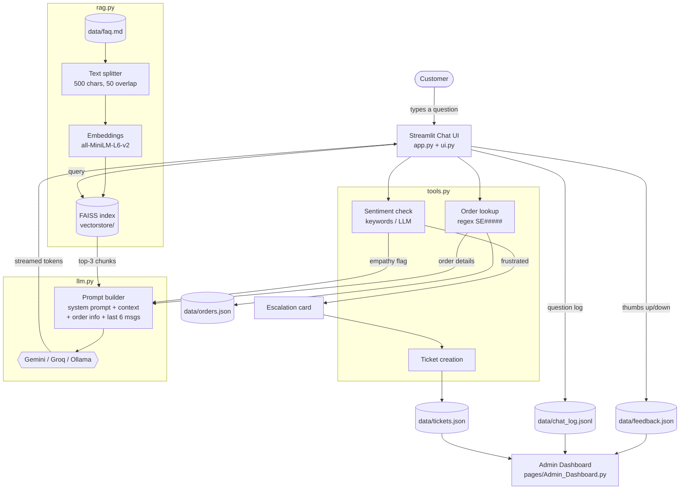

# AI Customer Support Chatbot Using a Pre-trained LLM

> **Ava**, a customer support assistant for **ShopEasy**, a fictional Indian e-commerce company. Ava
> uses a pre-trained Large Language Model with Retrieval-Augmented Generation (RAG), an
> order-tracking tool, sentiment detection and human escalation.

**Mini Project · Generative AI**

---

## Table of Contents

1. [Abstract](#1-abstract)
2. [Problem Statement](#2-problem-statement)
3. [Objectives](#3-objectives)
4. [System Architecture](#4-system-architecture)
5. [Tech Stack](#5-tech-stack)
6. [Working / Flow](#6-working--flow)
7. [Features](#7-features)
8. [Screenshots](#8-screenshots)
9. [How to Run](#9-how-to-run)
10. [Testing](#10-testing)
11. [Results](#11-results)
12. [Limitations](#12-limitations)
13. [Future Scope](#13-future-scope)
14. [References](#14-references)

---

## 1. Abstract

Customer support teams in e-commerce answer the same questions about delivery times, refunds,
returns and payments thousands of times a day. Rule-based chatbots cannot handle the variety of
natural language customers use, and plain LLM chatbots tend to "hallucinate" policies, prices
and order details that do not exist.

This project builds an AI customer support chatbot that combines a **pre-trained LLM (Google
Gemini, with Groq/Llama and local Ollama as alternatives)** with **Retrieval-Augmented
Generation**. The company's help-centre content (46 Q&As) is split into chunks, embedded with
the open-source `all-MiniLM-L6-v2` sentence-transformer and indexed in a **FAISS** vector
store. For every question, the three most relevant chunks are retrieved and the LLM is
instructed to answer **only** from them. A mock **order-tracking tool** answers order-specific
questions from a database. A **sentiment check** detects frustrated customers and offers
**escalation to a human agent** with a support ticket. The **Streamlit** interface streams
answers token by token. It also offers quick replies, answer feedback, source citations, light
and dark themes, a mobile layout and an **admin dashboard** with support analytics.

## 2. Problem Statement

- Support agents spend most of their time on repetitive, answerable questions, which leads to
  long queues and high costs.
- Traditional chatbots use fixed intents or keywords and fail on paraphrased questions.
- General-purpose LLMs answer fluently but can **invent** policies or order details, which is
  unacceptable for a business.
- Frustrated customers need to reach a human quickly, and the human needs the conversation
  context.

**Goal:** design a chatbot that understands free-form questions, answers accurately from the
company's own knowledge base, looks up real order data, recognises when a customer is upset,
and hands off to a human with full context.

## 3. Objectives

1. Use a **pre-trained LLM** through an API (no training required) and support multiple
   providers (Gemini, Groq, Ollama).
2. Implement **RAG** with LangChain, sentence-transformer embeddings and a FAISS index cached
   on disk.
3. **Ground** every answer in retrieved context to minimise hallucination, and say "I'm not
   sure" when the answer isn't known.
4. Support **multi-turn conversations** by keeping the last 6 messages as memory.
5. Integrate a **tool** (order lookup) for dynamic, customer-specific data.
6. Detect **negative sentiment** and provide **escalation** with ticket creation.
7. Provide a **modern, responsive UI** with streaming, feedback collection and an analytics
   dashboard.
8. Handle errors (missing API key, network failures, rate limits) **gracefully**.

## 4. System Architecture



### Module overview

| File | Responsibility |
|---|---|
| `app.py` | Streamlit entry point: chat flow, sidebar, escalation, feedback, multipage navigation |
| `ui.py` | All styling: CSS (Inter font, light/dark tokens, bubbles, cards, responsive rules) and HTML snippets |
| `config.py` | Settings and model choice. Loads `.env`, environment variables and Streamlit secrets |
| `rag.py` | Loading, chunking, embedding, FAISS build/load/cache, retrieval |
| `llm.py` | LLM clients (Gemini/Groq/Ollama), prompt templates, streaming, tool-calling loop, query translation, friendly error mapping |
| `agent.py` | Tool schemas the LLM sees (`lookup_order`, `cancel_order`, `create_support_ticket`) and their execution |
| `tools.py` | Order lookup and cancellation, sentiment detection, human-request detection, ticket creation |
| `storage.py` | JSON persistence for feedback, tickets, order updates and the question log |
| `pages/Admin_Dashboard.py` | Analytics: feedback, common questions, escalated tickets |
| `data/faq.md` | ShopEasy knowledge base (46 Q&As across 10 topics) |
| `data/orders.json` | 10 sample orders with different statuses |

## 5. Tech Stack

| Layer | Technology | Why |
|---|---|---|
| Language | Python 3.12 / 3.13 | Ecosystem for AI and data |
| UI | Streamlit 1.66 + custom CSS | Fast to build, with streaming, chat elements and multipage support |
| LLM (default) | Google Gemini `gemini-3.5-flash` via `langchain-google-genai` | Free tier, fast, high quality |
| LLM (alternatives) | Groq `llama-3.3-70b-versatile`, Ollama `llama3.2` | Provider choice, offline/local option |
| Orchestration | LangChain (core, community, text-splitters) | Standard interfaces for models, documents and vector stores |
| Embeddings | sentence-transformers `all-MiniLM-L6-v2` | Free, local, 384-dimensional, small (~90 MB) |
| Vector store | FAISS (CPU) | Fast similarity search, saved to disk |
| Analytics | pandas + Streamlit charts | KPIs and charts on the admin page |
| Config | python-dotenv, Streamlit secrets | Keeps API keys out of code |
| Deployment | Streamlit Community Cloud, Hugging Face Spaces (Docker) | Free hosting |

## 6. Working / Flow

**Startup**

1. `config.py` loads settings from `.env`, environment variables or Streamlit secrets.
2. `rag.py` reads `data/faq.md` and computes a SHA-256 fingerprint of the content plus settings.
3. If `vectorstore/` holds an index with the same fingerprint, it is **loaded from disk** (about
   0.01 s). Otherwise the FAQ is split with `RecursiveCharacterTextSplitter` (500 characters,
   50 overlap, preferring to split at `### Q:` headings), embedded and saved.

**For each message**

1. **Order tool:** a regular expression finds IDs like `SE12345`. Matching orders are read from
   `orders.json` and added to the prompt as an `ORDER LOOKUP` block. The last order ID is
   remembered so follow-ups such as "when will it arrive?" work.
2. **Sentiment check:** keyword rules (plus ALL-CAPS and `!!!` detection, optionally an LLM
   classifier) label the message *frustrated* or *neutral*. Requests for a human are detected
   separately.
3. **Retrieval:** the question is embedded and the **top 3** chunks are fetched from FAISS.
   Short follow-up questions are combined with the previous question to improve the search.
4. **Prompt:** system prompt ("You are Ava… Answer ONLY using the provided context… Never
   invent order details, prices or policies"), plus extra rules, plus an empathy instruction if
   the customer is frustrated, plus the context, plus the **last 6 messages**, plus the
   question.
5. **Generation:** the LLM streams tokens into the chat bubble while an "Ava is typing…"
   indicator is shown.
6. **After the answer:** order cards, a collapsible **Sources** list and 👍/👎 buttons are
   shown. If the customer is frustrated or asked for a human, an **escalation card** appears.
   Escalating creates a ticket (`TKT-YYYYMMDD-XXXXXX`, High priority with a 4-hour target for
   frustrated customers, Normal priority with a 24-hour target otherwise) that stores the
   recent transcript.
7. **Analytics:** each question is appended to `chat_log.jsonl` and ratings go to
   `feedback.json`. Both feed the Admin Dashboard.

**Error handling:** a missing key shows a setup banner and disables input. Invalid keys,
rate limits (HTTP 429), network errors, wrong model names and an offline Ollama server are
turned into friendly messages instead of tracebacks.

## 7. Features

**Chat experience**
- Modern chat UI: Inter font, gradient header with avatar and green "Online" status, rounded
  bubbles (user on the right in brand indigo `#4F46E5`, bot on the left in light grey), soft
  shadows
- Welcome card with **quick-reply chips**: Track my order, Return policy, Refund status,
  Payment options, Coupons, Talk to a human
- **Token-by-token streaming** with an animated "Ava is typing…" indicator
- **Timestamp** under every message, plus response time for bot replies
- **👍/👎 feedback** on every bot answer, saved to `data/feedback.json`
- Collapsible **Sources** showing the FAQ chunks used, and **order cards** for order lookups
- **Escalation flow:** styled card, then a ticket card with ticket ID, estimated response time
  and priority, then **Continue chatting**
- **AI agent (tool calling):** the LLM decides itself when to call `lookup_order`,
  `cancel_order` (only orders not yet shipped) or `create_support_ticket`. A "🛠️ Looked up
  SE12345" line under the answer shows which tools ran. Turn off in the sidebar to compare
  with the older keyword rules
- **Multilingual:** replies in English, Hindi, Marathi or Hinglish, matching the customer
  (or a fixed language chosen in the sidebar). Hindi/Marathi questions are translated to
  English before the FAQ search, because the knowledge base and embeddings are English
- **Light/dark mode** toggle (also `?theme=dark` in the URL)
- **Responsive** down to phone widths (390 px tested)
- Streamlit's default menu, footer and Deploy button are hidden

**Sidebar**
- Company logo, name and description
- **Model selector** (Gemini / Groq / Ollama) and **temperature slider**
- **Agent mode** toggle and **Reply language** selector
- **Automatic model fallback:** if the selected model is busy, times out or fails, the next
  model is tried automatically (backup Gemini models, then Groq if configured, then local
  Ollama). The reply shows which model answered. Configure with `ENABLE_FALLBACK` and
  `GEMINI_FALLBACK_MODELS`
- **New chat** and **Download chat transcript** (.txt)
- **Live stats:** messages this session, average response time, number of ratings

**Admin Dashboard** (`pages/Admin_Dashboard.py`, optional password)
- KPIs: questions, sessions, satisfaction %, tickets, average reply time
- Feedback charts, satisfaction by model, table of answers rated "Not helpful"
- Most common FAQ topics, most frequent questions, questions per day, sentiment, model usage
- Escalated tickets by priority and day, full table, transcript viewer, CSV exports

## 8. Screenshots

> Replace the placeholders below with your own screenshots. Save them in `docs/screenshots/`
> and update the paths.

| Screen | Screenshot |
|---|---|
| Welcome screen with quick replies | `` |
| Order tracking answer with order card and sources | `` |
| Angry customer, empathy reply and escalation card | `` |
| Ticket card with ticket ID | `` |
| Dark mode | `` |
| Mobile view | `` |
| Admin Dashboard | `` |

## 9. How to Run

**Requirements:** Python **3.12 or 3.13** (`python --version`), internet for the first run
(to download the ~90 MB embedding model), and a free Gemini API key from
<https://aistudio.google.com/app/apikey>.

### Windows (PowerShell)

```powershell
cd support-chatbot
python -m venv .venv
.\.venv\Scripts\Activate.ps1
python -m pip install --upgrade pip
pip install -r requirements.txt
copy .env.example .env
notepad .env          # set GOOGLE_API_KEY=... and save
streamlit run app.py
```

If PowerShell blocks `Activate.ps1`, run `Set-ExecutionPolicy -Scope CurrentUser RemoteSigned`
once, or use Command Prompt with `.venv\Scripts\activate.bat`.

### Linux / macOS

```bash
cd support-chatbot
python3 -m venv .venv
source .venv/bin/activate
python -m pip install --upgrade pip
# Optional on Linux: CPU-only PyTorch avoids a multi-GB CUDA download
# pip install torch==2.15.0 --index-url https://download.pytorch.org/whl/cpu
pip install -r requirements.txt
cp .env.example .env
nano .env             # set GOOGLE_API_KEY=... and save
streamlit run app.py
```

The app opens at <http://localhost:8501>. The first launch takes 15–30 s while the
embedding model downloads. The **Admin Dashboard** is in the sidebar navigation.
A "You are sending unauthenticated requests to the HF Hub" message in the terminal is harmless.

### Switching the LLM

Use the sidebar selector, or set the default in `.env`:

```ini
LLM_PROVIDER=groq          # needs GROQ_API_KEY (free at https://console.groq.com/keys)
LLM_PROVIDER=ollama        # local: install https://ollama.com, then `ollama pull llama3.2`
```

### Deployment

See **[DEPLOYMENT.md](DEPLOYMENT.md)** for Streamlit Community Cloud (secrets setup) and
Hugging Face Spaces (Docker).

## 10. Testing

- **[TEST_CASES.md](TEST_CASES.md)** has 10 test questions, covering order tracking,
  follow-ups, an out-of-scope question, an angry customer, a human request, an invalid order ID
  and prompt injection, with the expected behaviour for each, plus extra checks for errors,
  dark mode, mobile and the dashboard.
- Module self-tests:

  ```bash
  python rag.py     # builds/loads the index and prints retrieved FAQ titles
  python tools.py   # order lookup and sentiment detection
  ```

## 11. Results

Measured on the development laptop (Windows 11, CPU only, Python 3.13):

| Metric | Result |
|---|---|
| Knowledge base | 46 Q&As → 45 chunks |
| First-time index build (embedding all chunks) | ~1.9 s (plus ~20 s one-time model load) |
| Loading the cached index on later runs | ~0.01 s |
| Retrieval latency (embed query + FAISS search) | ~26 ms per question |
| Retrieval accuracy on 10 paraphrased questions: correct FAQ in **top-3** | **10 / 10** |
| Correct FAQ ranked **first** | 4 / 10. Retrieving 3 chunks instead of 1 is what makes RAG reliable here |
| Order-ID detection (`SE12345`, `se12345`, several IDs per message) | Correct on all test inputs |
| Frustration detection on the test messages | Angry message flagged. Neutral questions not flagged |

**LLM response quality** (fill in after running [TEST_CASES.md](TEST_CASES.md) with your API key;
the Admin Dashboard shows average reply time and satisfaction):

| Metric | Your result |
|---|---|
| Test cases passed (out of 10) | … |
| Average reply time (Admin Dashboard) | … s |
| Answers rated 👍 | … % |

**Design observations** (confirm them with test cases 2, 6, 7 and 10)
- The order tool supplies exact statuses and dates that the LLM could never know on its own.
  For an unknown ID it supplies an explicit "NOT FOUND", so the model has nothing to invent.
- For out-of-scope questions ("Do you sell cars?") the retriever returns only unrelated FAQs,
  so the strict system prompt should make the model say it isn't sure and offer a human agent.
- The remembered order ID plus 6-message memory lets follow-ups ("When will it arrive?") work
  without repeating the order ID.

## 12. Limitations

- **Mock data:** orders come from a static JSON file, not a real order system, and there is no
  customer authentication, so anyone who knows an order ID can view it.
- **Simple sentiment detection:** keyword rules can miss sarcasm or polite frustration, and
  can flag harmless uses of words like "hate". The optional LLM mode costs an extra API call.
- **Ephemeral storage:** feedback, tickets and logs are JSON files. They are not suitable for
  many simultaneous users and are reset on cloud redeploys.
- **Retrieval limits:** a small embedding model and fixed top-3 retrieval can miss answers
  spread across many chunks.
- **External dependency:** the default LLM needs internet access and is subject to free-tier
  rate limits. Response wording varies between runs.
- **Multilingual limits:** the interface text and keyword sentiment rules are English (plus a
  few Hinglish words); Hindi/Marathi questions need one extra LLM call for translation.
  No voice input.
- **Agent decisions:** the LLM chooses when to act, so smaller models (e.g. Ollama
  `llama3.2`) may skip a tool or call it with a wrong ID. Cancellations are checked by code
  (only "Placed"/"Processing" orders), and nothing is deleted from `orders.json`.

## 13. Future Scope

- Connect to a real order-management system or database with customer login (OTP/OAuth)
- Hybrid search (BM25 + vectors) and a cross-encoder re-ranker for better retrieval
- More Indian languages and voice input/output
- Integration with a real helpdesk (Zendesk, Freshdesk, Jira Service Management) to create
  tickets
- Automatic evaluation with RAGAS (faithfulness, answer relevance)
- Learning from 👎 feedback to improve the knowledge base
- Deployment on WhatsApp, Telegram or as an embeddable website widget
- A proper database (PostgreSQL / Firestore) and authentication for the admin dashboard

## 14. References

1. P. Lewis et al., "Retrieval-Augmented Generation for Knowledge-Intensive NLP Tasks,"
   *NeurIPS*, 2020. <https://arxiv.org/abs/2005.11401>
2. N. Reimers and I. Gurevych, "Sentence-BERT: Sentence Embeddings using Siamese BERT-Networks,"
   *EMNLP*, 2019. <https://arxiv.org/abs/1908.10084>
3. J. Johnson, M. Douze and H. Jégou, "Billion-scale similarity search with GPUs,"
   *IEEE Transactions on Big Data*, 2019 (FAISS). <https://arxiv.org/abs/1702.08734>
4. A. Vaswani et al., "Attention Is All You Need," *NeurIPS*, 2017.
   <https://arxiv.org/abs/1706.03762>
5. LangChain documentation. <https://python.langchain.com>
6. Google AI for Developers: Gemini API documentation. <https://ai.google.dev>
7. Streamlit documentation. <https://docs.streamlit.io>
8. Hugging Face: `sentence-transformers/all-MiniLM-L6-v2` model card.
   <https://huggingface.co/sentence-transformers/all-MiniLM-L6-v2>
9. FAISS library. <https://github.com/facebookresearch/faiss>
10. Groq API documentation. <https://console.groq.com/docs> · Ollama. <https://ollama.com>

---

### Project structure

```
support-chatbot/
├── app.py                    # Streamlit entry point (chat page + navigation)
├── ui.py                     # CSS theme, chat bubbles, header, cards
├── config.py                 # settings, model choice, loads .env / secrets
├── rag.py                    # loading, chunking, embedding, retrieval
├── llm.py                    # LLM client + prompt templates (Gemini/Groq/Ollama)
├── agent.py                  # tool schemas + execution (tool calling)
├── tools.py                  # order lookup/cancel, sentiment, ticket creation
├── storage.py                # JSON storage for feedback, tickets, chat log
├── pages/
│   └── Admin_Dashboard.py    # analytics page
├── data/
│   ├── faq.md                # knowledge base
│   └── orders.json           # sample orders
├── .streamlit/
│   ├── config.toml           # theme + hides the Deploy button
│   └── secrets.toml.example  # template for Streamlit Cloud secrets
├── requirements.txt          # pinned versions
├── .env.example
├── Dockerfile                # Hugging Face Spaces / Docker
├── DEPLOYMENT.md
├── TEST_CASES.md
└── README.md
```

Files created at runtime (ignored by Git): `vectorstore/`, `data/tickets.json`,
`data/feedback.json`, `data/chat_log.jsonl`, `data/order_updates.json` (delete it to undo
cancellations made during testing).
